<div align="center">

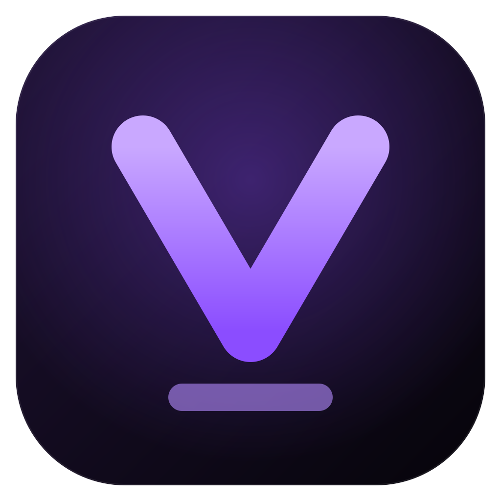

# Vibax

**Cole o link. Veja as qualidades reais. Baixe sem anúncios.**

Um aplicativo para Windows que analisa vídeos, mostra exatamente o que a fonte oferece
e gerencia seus downloads direto no seu computador — sem sites intermediários, contas ou assinaturas.

[](https://github.com/angelotho/Vibax/releases/latest)
[](https://github.com/angelotho/Vibax/releases)
[](#requisitos)
[](LICENSE.md)

[](https://tauri.app)
[](https://www.rust-lang.org)
[](https://react.dev)
[](https://www.typescriptlang.org)
[](https://tailwindcss.com)

[**Baixar para Windows**](https://github.com/angelotho/Vibax/releases/latest) ·
[Recursos](#recursos) ·
[Capturas](#capturas) ·
[Como funciona](#como-funciona) ·
[Desenvolvimento](#desenvolvimento)

<br />

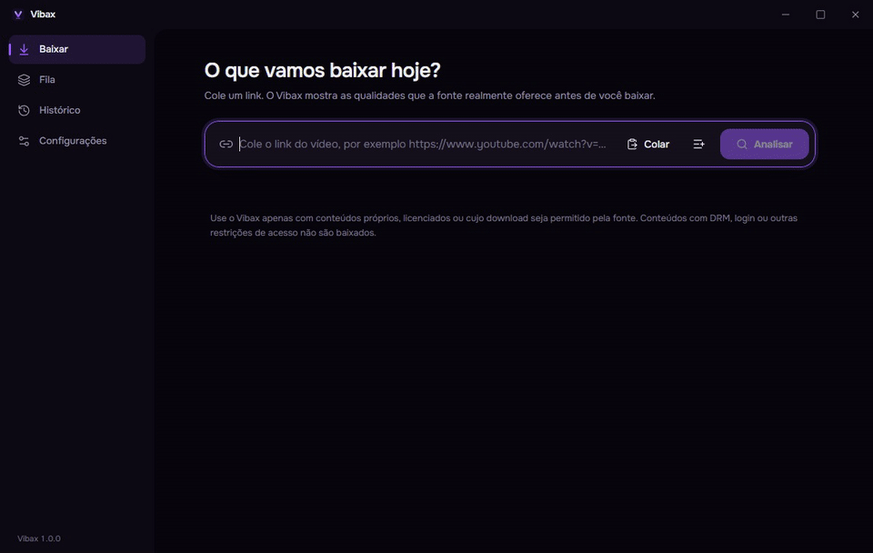

<sub>Gravação real do aplicativo. A espera durante a análise foi acelerada.</sub>

</div>

---

## ✨ Por que o Vibax?

Baixar um vídeo autorizado não deveria significar enfrentar pop-ups, esperas artificiais ou planos pagos
para funções básicas. O Vibax roda **inteiro no seu computador** e mostra a informação que importa antes do download.

| O problema comum | Como o Vibax resolve |
| --- | --- |
| Sites lentos, cheios de anúncios e redirecionamentos | Aplicativo nativo, sem anúncios, rastreadores ou monetização |
| Promessas de "4K" que entregam outra qualidade | Só aparecem as resoluções que a fonte **realmente** oferece, com o tamanho estimado de cada uma |
| Assinatura para baixar mais de um arquivo | Fila ilimitada, com downloads simultâneos configuráveis |
| Instalar Python, FFmpeg e usar terminal | Tudo incluído no instalador; basta abrir pelo menu Iniciar |
| Downloads que recomeçam do zero | Pausa e retomada reais, de onde parou |
| Contas e coleta de dados | Sem login, sem cookies, sem servidor próprio. Seus dados ficam no seu PC |

<a id="recursos"></a>

## 🚀 Recursos

<table>
<tr>
<td width="50%" valign="top">

### 🔎 Análise inteligente
- Miniatura, título, canal, duração e origem
- Qualidades reais de **144p a 4K** (e 8K, se existir)
- Tamanho estimado de cada opção antes de baixar
- Playlists: veja os itens e adicione todos de uma vez
- Sugestão automática do link que você copiou

</td>
<td width="50%" valign="top">

### 🎬 Formatos
- **MP4** como padrão, priorizando H.264 pela compatibilidade
- **WebM** e **MKV** quando a fonte permite
- Áudio em **MP3** (128 a 320 kbps) ou **M4A**
- Vídeo e áudio combinados automaticamente, sem perda
- Título, capítulos e capa gravados no arquivo

</td>
</tr>
<tr>
<td valign="top">

### 📥 Gerenciador de downloads
- Fila com 1 a 6 downloads simultâneos
- Progresso, velocidade, tamanho e tempo restante ao vivo
- Pausar, retomar, cancelar, tentar de novo e remover
- Vários links colados de uma só vez
- Nova tentativa automática em falhas temporárias
- Downloads interrompidos são retomáveis ao reabrir

</td>
<td valign="top">

### 🗂️ Histórico e preferências
- Histórico local com busca tolerante a acentos e filtros
- Abrir arquivo, mostrar na pasta ou baixar novamente
- Aviso quando um arquivo foi movido ou excluído
- Pasta, formato e qualidade padrão; tema escuro, claro ou do Windows
- Notificações do Windows ao concluir ou falhar

</td>
</tr>
</table>

<a id="capturas"></a>

## 🖼️ Capturas de tela

<table>
<tr>
<td width="50%">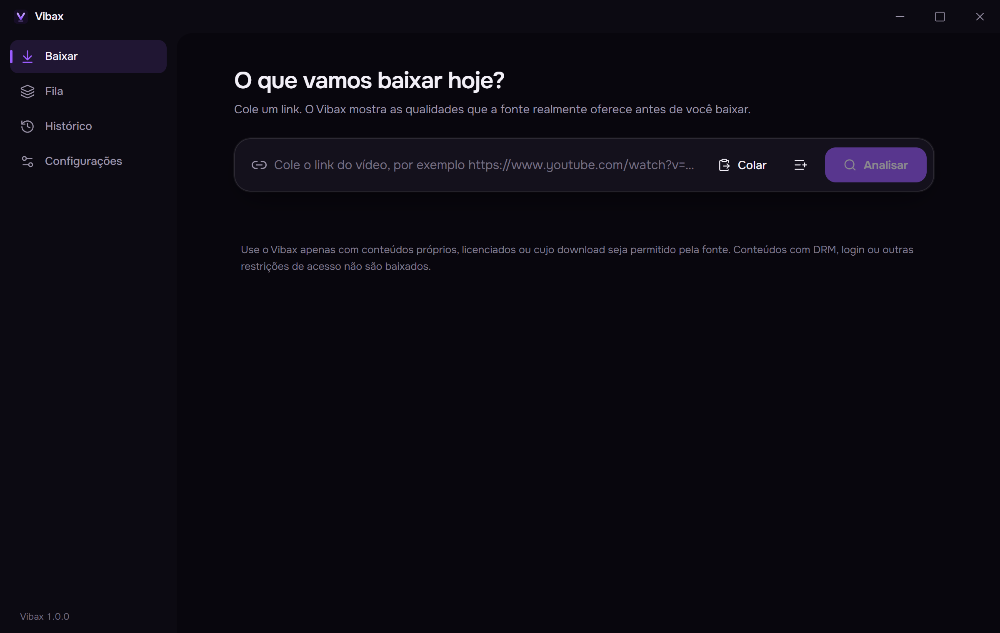<p align="center"><sub><b>Tela inicial</b>: um campo, um objetivo.</sub></p></td>
<td width="50%">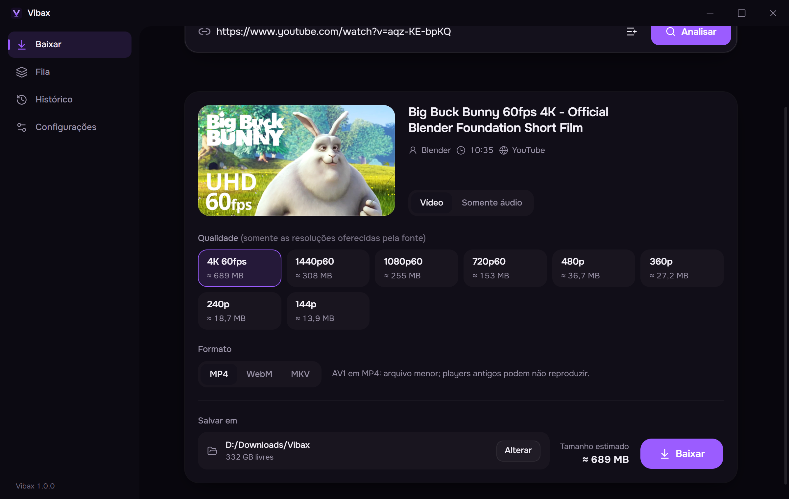<p align="center"><sub><b>Prévia</b>: somente as qualidades oferecidas pela fonte.</sub></p></td>
</tr>
<tr>
<td>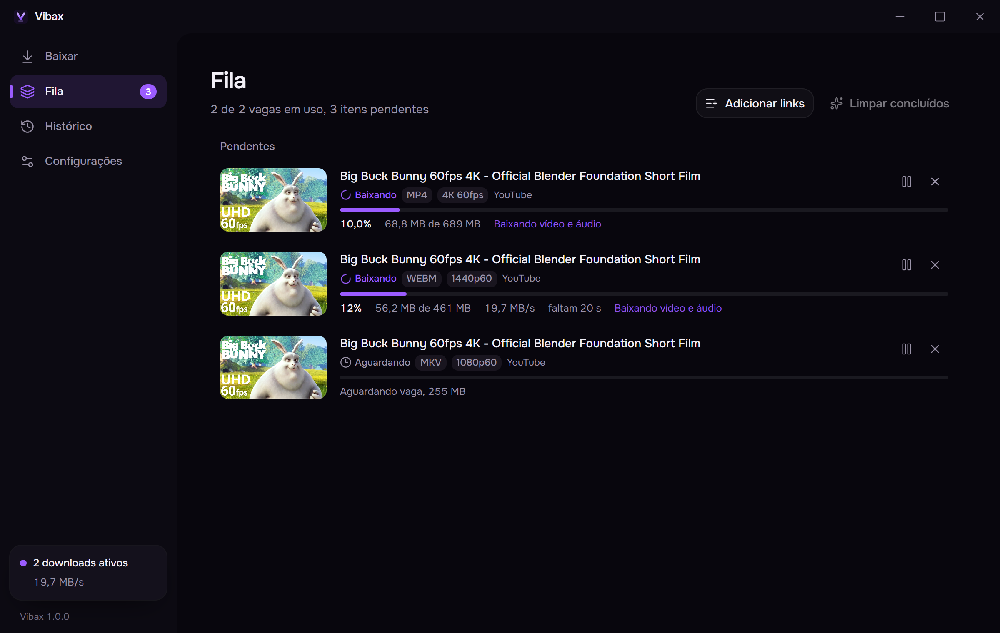<p align="center"><sub><b>Fila</b>: downloads simultâneos com progresso ao vivo.</sub></p></td>
<td>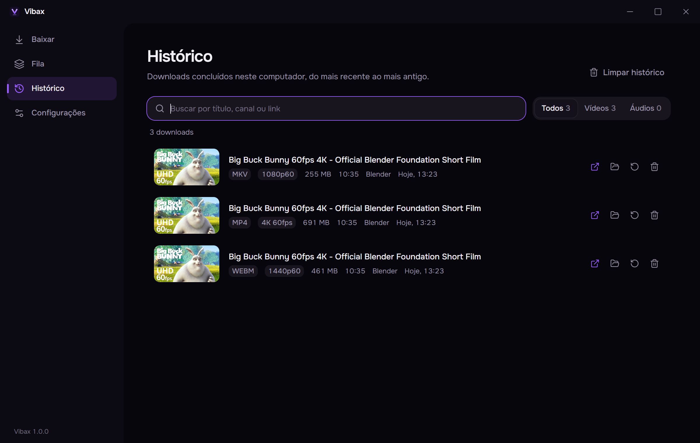<p align="center"><sub><b>Histórico</b>: encontre e abra qualquer arquivo baixado.</sub></p></td>
</tr>
<tr>
<td>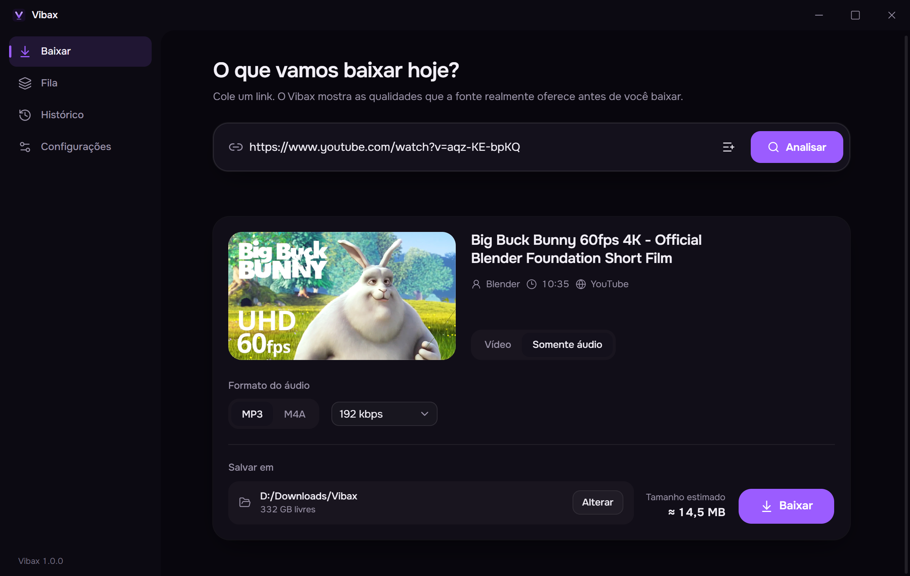<p align="center"><sub><b>Somente áudio</b>: MP3 ou M4A.</sub></p></td>
<td>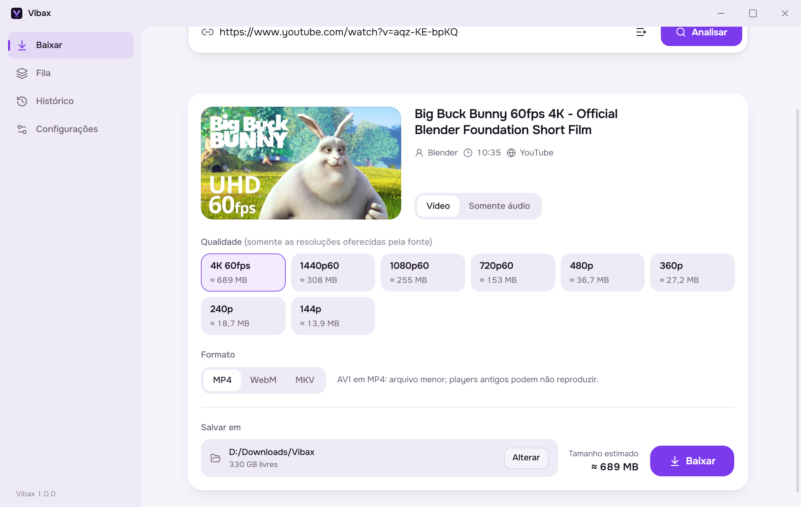<p align="center"><sub><b>Tema claro</b>, escuro ou igual ao Windows.</sub></p></td>
</tr>
<tr>
<td>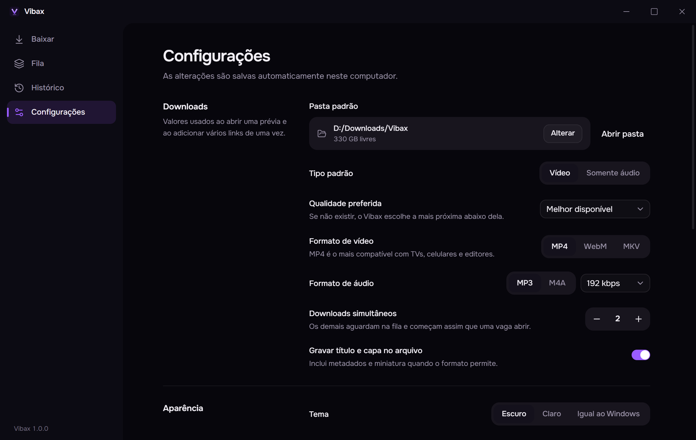<p align="center"><sub><b>Configurações</b> salvas automaticamente.</sub></p></td>
<td>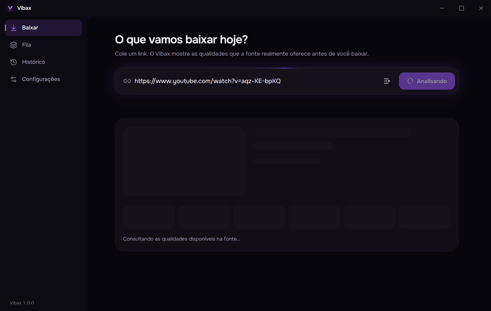<p align="center"><sub><b>Análise</b> em andamento.</sub></p></td>
</tr>
</table>

## 📦 Download e instalação

1. Acesse a página de **[Releases](https://github.com/angelotho/Vibax/releases/latest)** e baixe
   `Vibax_1.0.0_x64-setup.exe`.
2. Execute o instalador. Ele instala apenas para o seu usuário e **não pede permissão de administrador**.
3. Abra o Vibax pelo **menu Iniciar** ou pelo atalho na área de trabalho.

> [!NOTE]
> O instalador ainda não tem assinatura digital de código. Na primeira execução, o Windows SmartScreen pode
> exibir "O Windows protegeu o computador". Clique em **Mais informações → Executar assim mesmo**. Se quiser,
> confira a integridade comparando o SHA-256 do arquivo com o `SHA256SUMS.txt` publicado na Release:
>
> ```powershell
> Get-FileHash .\Vibax_1.0.0_x64-setup.exe -Algorithm SHA256
> ```

Para atualizar, basta instalar a versão nova por cima da anterior: fila, histórico e configurações são mantidos.

### Como usar

1. **Cole** o link na tela *Baixar* (o Vibax também sugere o link que você acabou de copiar).
2. **Escolha** a qualidade e o formato entre as opções que a fonte oferece.
3. **Baixe** e acompanhe tudo na *Fila*. Os arquivos ficam em `Downloads\Vibax`, ou na pasta que você escolher.

<a id="requisitos"></a>

## 💻 Requisitos

| | |
| --- | --- |
| Sistema | Windows 11 x64 (testado). Windows 10 x64 é compatível com a plataforma, mas ainda não foi testado. |
| WebView2 | Já incluso no Windows 11. Se faltar, o instalador o baixa automaticamente. |
| Espaço | ~330 MB para o aplicativo e seus componentes, além do espaço dos seus downloads |
| Internet | Necessária para analisar e baixar. Nenhuma conta é necessária. |

## 🛡️ Privacidade e uso responsável

- **Sem contas, anúncios ou rastreadores.** A fila, o histórico e as preferências ficam apenas no seu computador.
- **Sem cookies nem credenciais.** O Vibax não lê dados do navegador nem pede login.
- **Respeito às restrições.** Conteúdos com DRM, login, paywall, restrição de idade ou de região **não são
  baixados**, e o aplicativo explica o motivo.

> [!IMPORTANT]
> Use o Vibax somente com conteúdos **próprios, licenciados ou cujo download seja expressamente permitido**.
> Respeite os direitos autorais e os termos de uso de cada plataforma. Você é responsável pelo uso que fizer
> dos arquivos baixados.

<a id="como-funciona"></a>

## ⚙️ Como funciona

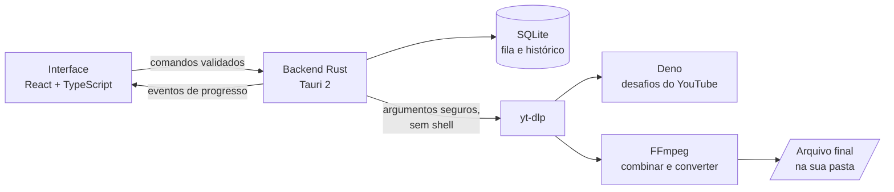

1. O link é validado (apenas `http`/`https`, sem credenciais embutidas).
2. O yt-dlp descreve todos os formatos; o Vibax agrupa por resolução e escolhe a melhor combinação de vídeo e
   áudio para cada formato de saída.
3. Na fila, cada download roda em segundo plano com arquivos temporários no mesmo disco do destino, e o
   progresso chega à interface em tempo real.
4. O FFmpeg combina os fluxos e grava os metadados; o arquivo é movido para a pasta final e entra no histórico.

A arquitetura completa, as decisões técnicas e o modelo de segurança estão em
[**docs/ARQUITETURA.md**](docs/ARQUITETURA.md).

<a id="desenvolvimento"></a>

## 🧑‍💻 Para desenvolvedores

### Tecnologias

| Camada | Tecnologias |
| --- | --- |
| Desktop | [Tauri 2](https://tauri.app) com WebView2 |
| Backend | Rust, Tokio, rusqlite (SQLite), reqwest, Job Objects do Windows |
| Interface | React 19, TypeScript 7, Vite 8, Tailwind CSS 4, shadcn/ui (Radix), Zustand, Lucide |
| Mídia | [yt-dlp](https://github.com/yt-dlp/yt-dlp), [FFmpeg](https://ffmpeg.org), [Deno](https://deno.com) |
| Testes | `cargo test` (unitários e integração) e Vitest |
| Instalador | NSIS, gerado pelo Tauri |

### Pré-requisitos

- Windows 10/11 x64
- [Node.js](https://nodejs.org) 22 ou superior
- [Rust](https://rustup.rs) estável (toolchain `x86_64-pc-windows-msvc`)
- Visual Studio Build Tools com **Desenvolvimento para desktop com C++** e Windows SDK

### Executar e compilar

```powershell
git clone https://github.com/angelotho/Vibax.git
cd Vibax
npm install
npm run fetch-binaries   # baixa yt-dlp, FFmpeg e Deno oficiais e confere o SHA-256
npm run tauri dev        # executa em modo de desenvolvimento
npm run tauri build      # gera o instalador em src-tauri\target\release\bundle\nsis
```

> [!TIP]
> Use a letra da unidade em maiúscula (`D:\...`) ao abrir o terminal. No Windows, `d:\...` pode fazer o
> Vite/Vitest carregar módulos duas vezes.

### Testes

```powershell
npm test                     # interface (Vitest)
cd src-tauri; cargo test     # 20 testes unitários + 12 de integração
```

Os testes de integração usam os componentes empacotados com o `PATH` reduzido ao `System32`, provando que o
aplicativo não depende de programas instalados na máquina. Eles cobrem análise, download, combinação, pausa e
retomada (com verificação do HTTP Range), cancelamento, limite de simultâneos, falta de permissão,
recuperação após fechamento inesperado, links inválidos e o ciclo completo de atualização do yt-dlp.
Use `VIBAX_SKIP_NETWORK=1` para pular os testes que acessam a internet.

### Estrutura do projeto

```text
Vibax/
├── src/                      # Interface (React + TypeScript)
│   ├── pages/                # Baixar, Fila, Histórico, Configurações
│   ├── components/           # layout, download, queue, common e ui (shadcn)
│   ├── store/                # estado global (Zustand)
│   ├── hooks/                # eventos do backend, tema, área de transferência
│   └── lib/                  # api.ts (única ponte com o Rust), tipos e formatação
├── src-tauri/                # Backend (Rust + Tauri 2)
│   ├── src/
│   │   ├── commands.rs       # comandos expostos à interface
│   │   ├── downloads/        # fila, agendador e ciclo de vida das tarefas
│   │   ├── ytdlp/            # formatos, argumentos, progresso e erros
│   │   ├── storage/          # SQLite e configurações
│   │   ├── tools.rs          # localização dos componentes
│   │   ├── updater.rs        # atualização verificada do yt-dlp
│   │   └── process.rs        # processos seguros e Job Objects
│   ├── tests/                # testes de integração
│   ├── capabilities/         # permissões mínimas do Tauri
│   └── tauri.conf.json       # janela, CSP e instalador
├── scripts/fetch-binaries.mjs
└── docs/                     # documentação técnica e imagens
```

## ⚠️ Limitações conhecidas

- Conteúdo com login, idade restrita, área de membros, DRM ou bloqueio regional não é baixado (por decisão de projeto).
- Transmissões ao vivo não são suportadas.
- No YouTube, MP4 em 1440p e 4K usa o codec **AV1**, que players antigos podem não reproduzir; o aplicativo avisa.
- As plataformas mudam com frequência. Se os downloads começarem a falhar, use
  **Configurações → Atualizar o yt-dlp**.
- Pausar e retomar depende de o servidor aceitar downloads parciais (HTTP Range).
- O Vibax ainda não se atualiza sozinho: novas versões são instaladas pelo instalador da página de Releases.
- O instalador tem ~105 MB, principalmente por causa do FFmpeg e do Deno.

## 🤝 Créditos

O Vibax existe graças a projetos excepcionais da comunidade:

- **[yt-dlp](https://github.com/yt-dlp/yt-dlp)**: o mecanismo que analisa e baixa os vídeos (Unlicense).
- **[FFmpeg](https://ffmpeg.org)**: combina, converte e grava metadados (GPLv3 nesta distribuição; o código-fonte
  correspondente está indicado em [THIRD-PARTY-NOTICES.md](THIRD-PARTY-NOTICES.md)).
- **[Deno](https://deno.com)**: executa os desafios JavaScript exigidos pelo YouTube (MIT).
- **[Tauri](https://tauri.app)**, **[React](https://react.dev)**, **[shadcn/ui](https://ui.shadcn.com)**,
  **[Radix UI](https://www.radix-ui.com)**, **[Tailwind CSS](https://tailwindcss.com)** e
  **[Lucide](https://lucide.dev)**.
- Vídeo usado nas capturas e nos testes: *Big Buck Bunny*, © Blender Foundation,
  [CC BY 3.0](https://creativecommons.org/licenses/by/3.0/), [peach.blender.org](https://peach.blender.org).

Esses componentes são programas independentes e mantêm as próprias licenças.
Veja **[THIRD-PARTY-NOTICES.md](THIRD-PARTY-NOTICES.md)**.

## 📄 Licença

O código do Vibax é distribuído sob a **[PolyForm Noncommercial License 1.0.0](LICENSE.md)**.

- ✅ Você pode usar, estudar, modificar e compartilhar o Vibax para fins **não comerciais**.
- ❌ Não é permitido vender o Vibax ou usá-lo comercialmente.

Copyright © 2026 [angelotho](https://github.com/angelotho). Veja também o [CHANGELOG](CHANGELOG.md).

<div align="center">
<br />
<sub>Feito com cuidado para quem quer uma ferramenta rápida, honesta e sem distrações.</sub>
</div>
